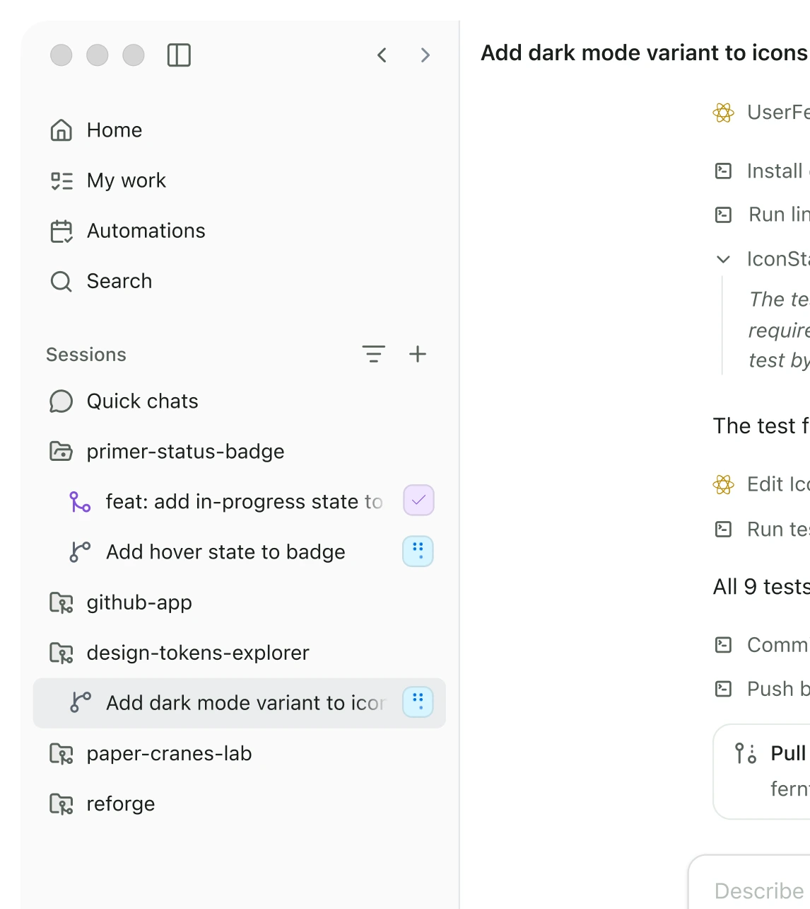
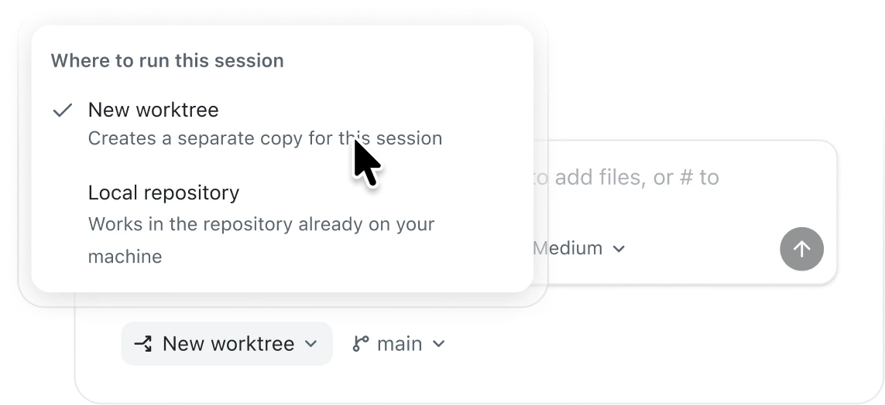
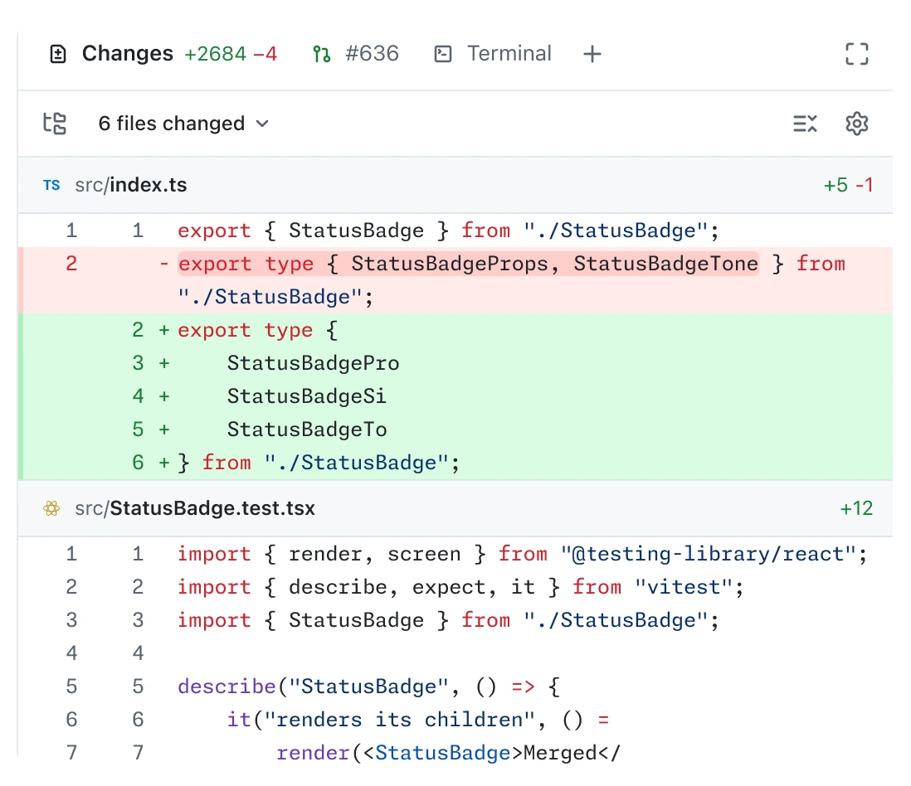
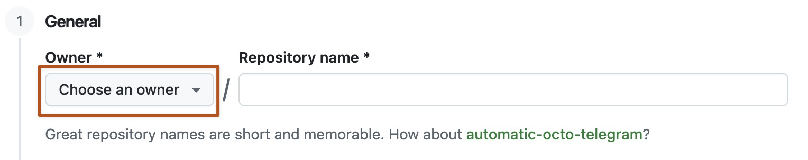
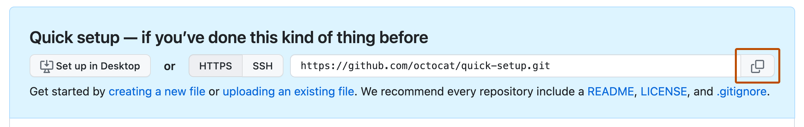

# From idea to your first GitHub project

## A beginner learning path with the GitHub Copilot app

**Audience:** People with little or no software-development experience.  
**Time:** About 90-120 minutes, after account and software setup.  
**Your project:** A small **Learning Tracker** that remembers what you want to learn.  
**Your finish line:** A working, documented, reviewed project in your GitHub organization.

You do not need to memorize programming syntax. Your job is to explain the goal, make decisions, check the result, and decide what gets shared. Copilot helps you write the code; you remain responsible for the outcome.

**The workflow:** Describe -> Plan -> Document -> Build -> Test -> Review -> Push.

This guide is for the **standalone GitHub Copilot desktop app**. It is not a guide to Microsoft 365 Copilot, GitHub Desktop, or the Copilot extension in Visual Studio Code.

### Before you begin

- Accept your organization's GitHub invitation. Complete any required sign-in or single sign-on (SSO) steps.
- Have the GitHub Copilot app installed and signed in with the invited account, with Copilot access enabled by your organization.
- Have **Git** installed. For this example, also have an organization-approved **Node.js LTS** installation for running the app locally and running tests. Ask the facilitator for setup help; do not install unfamiliar tools just because an agent suggests them.
- Know your organization name, the required repository visibility, and whether its rules allow the first push to a new repository's `main` branch.
- Use fictional learning topics only. Do not paste passwords, API keys, customer information, or confidential documents into the exercise.

Replace `YOUR-ORG` and `YOUR-USERNAME` when they appear below. Organization membership and Copilot access are separate: accepting an invitation does not necessarily enable Copilot.

### Five words you will use

| Word | Plain-language meaning |
|---|---|
| Project / repository | Your project is a folder of files. A Git repository also records their change history. A copy on GitHub lets others collaborate. |
| Session | One conversation and working context with Copilot for a task. |
| Commit | A named snapshot of selected changes, initially saved locally. |
| Push | Uploading local commits to a repository on GitHub. Saving a file or making a commit does not push it. |
| Branch / pull request | A branch keeps a line of work separate. A pull request, or PR, asks people to review and merge that work. |

## 1. Meet the app and start a project

**Allow 10 minutes.** Learn these controls; ignore advanced customization and automation for now.



*Screenshot 1: GitHub's published app navigation example. It uses older labels, including **Sessions** and **Quick chats**. Current documentation calls these areas **Projects** and **Chats**. Screenshots in this guide are published macOS examples; Windows controls and newer versions can look different. Follow the current labels in the instructions. [Image sources](SOURCES.md).*

| Area | What you need it for today |
|---|---|
| **Projects** in the sidebar | Connect your project folder and return to its session. |
| Prompt box | Tell Copilot what you want. Read its questions and answers here. |
| Mode dropdown below the prompt | Choose **Plan** before building, then **Interactive** for controlled implementation. |
| **Changes** above the prompt | Inspect which files and lines changed. |
| Browser / terminal canvas | See the running app or commands. You can ask Copilot to open these for you. |
| **My work** | Find GitHub issues and pull requests later. |

### Start with an empty local folder

1. In your computer's file manager, create a folder named `learning-tracker-YOUR-USERNAME`. On Windows, a suitable location is `C:\Users\YOUR-NAME\Projects\learning-tracker-YOUR-USERNAME`. Do not select your whole home folder, Downloads folder, or a folder containing unrelated work.
2. In the app sidebar, click **+** next to **Projects**.
3. Under **Add project from**, choose **Local folder or repository**, then select your new folder.
4. Under **Projects**, find the connected folder and click **+** next to it to start a session.
5. Stay in that project and session throughout this first exercise. For a plain folder, work in that folder. If a repository location picker appears, choose **Local repository** for this one-person lab, not a cloud session or a separate worktree.
6. Leave the model on **Auto**, or the model your facilitator recommends. Select **Plan** in the mode dropdown. Do not send a request to build yet.



*Screenshot 2: The location picker for an existing Git repository. The screenshot selects **New worktree**, which creates a separate working copy; this introductory exercise uses **Local repository** instead when the picker is available. An empty, non-Git folder may not show this menu.*

**Why start locally?** You can experiment before sharing anything. Connecting a local folder does **not** create a repository in the organization or upload your files. We will do that after review.

**Checkpoint:** You can identify the selected project, its folder, and the **Plan** mode control.

## 2. Write the whole brief before sending the Plan-mode prompt

**Allow 15 minutes.** Plan mode is a conversation about the work, not a magic "make it correct" button.

| Mode | How to use it in this learning path |
|---|---|
| **Plan** | Clarify requirements and propose an approach. Review before approving implementation. |
| **Interactive** | Build in small, agreed steps and respond to questions and permission requests. |
| **Autopilot** | More autonomous execution. Skip it for this first exercise. |

Interactive mode is not a promise to ask before every line of code. Keep normal permission prompts and organization controls enabled. Do not enable blanket tool auto-approval.

### Prepare your brief

Write your first prompt in a note before sending it. Use this checklist to remove avoidable ambiguity:

| Consider | Write down | Learning Tracker example |
|---|---|---|
| Problem and outcome | What problem are we solving? | I forget what I want to learn and what I have finished. |
| User | Who will use it? | One beginner using their own browser. |
| Main journey | What will the user actually do? | Add a topic, mark it done, filter the list, return later. |
| First-version scope | What must work? What is excluded? | Four small features; no accounts, sharing, notifications, or deployment. |
| Data | What is stored, where, and how sensitive is it? | Fictional topic titles and completion states, in this browser only. |
| Constraints | Devices, technology, budget, installation limits? | Simple web page; no paid services or new packages without approval. |
| Success | What could another person check? | A topic remains after refresh; empty input is rejected. |
| Unknowns | What should Copilot ask rather than assume? | Duplicate titles, ordering, and what happens if saving fails. |

Avoid "Build a nice app that works." Prefer observable outcomes. "Nice," "simple," and "user-friendly" are useful intentions, but they are not testable requirements on their own.

### Copy-ready first prompt

For the guided exercise, use the complete prompt below. For your own idea, rewrite the goal, journey, scope, data, and success conditions **before** you send it.

```text
You are my software-development coach. I am a beginner.
Help me plan a small application in plain language.

MODE AND BOUNDARIES
We are planning, not implementing.
You may inspect the selected project and check relevant installed tools.
Do not write application code, install packages, create cloud resources,
commit, push, or publish anything. Do not inspect unrelated folders.

GOAL AND USER
I want a Learning Tracker for one person who wants to remember what to
learn next and what they have completed.
Success means I can capture a topic, change its completion state,
find unfinished topics, and return after a browser refresh without
losing my list.

MAIN USER JOURNEY
Open the page -> enter a topic -> add it to the list -> mark it done
or reopen it -> filter the list -> refresh and continue later.

FIRST-VERSION SCOPE
1. Add a topic with a title of 1-80 characters after trimming whitespace.
   Reject empty, whitespace-only, and overlong titles with a clear message.
2. Mark an individual topic as done and change it back to "to learn".
3. Remember topics and completion states in the same browser after refresh.
4. Filter between All, To learn, and Done, including a helpful empty state.

OUT OF SCOPE
No accounts, team sharing, editing or deleting topics, due dates,
notifications, AI features inside the app, external APIs, databases,
paid services, or internet deployment.

DATA AND TECHNICAL CONSTRAINTS
Use fictional topic titles only; no personal or confidential information.
Use plain HTML, CSS, and JavaScript for the browser app.
Node.js LTS is the workshop's approved local runtime; use it only for
local serving and tests. Prefer its built-in capabilities over packages.
Propose npm start for local preview and npm test for automated tests.
The preview server must listen only on the local machine.
Confirm the relevant tools are available before relying on them.
Explain any additional tool or dependency and ask before adding it.
Explain what browser-local storage does and does not protect or preserve.

QUALITY AND SUCCESS
The app must work with a keyboard and at a 375-pixel-wide viewport.
User-entered text must be displayed as text, not interpreted as HTML.
Test normal use, invalid input, refreshing, and empty filter results.
Include a visible, honest response if browser storage cannot be used.
Keep the code and documentation understandable to a beginner.

ASK ME; DO NOT SILENTLY DECIDE
Before finalizing the plan, ask about missing or ambiguous requirements.
Ask one focused question at a time and WAIT for my answer.
Give 2-3 clear options, a recommendation, and a short explanation.
In particular, ask about duplicate topic titles, list ordering,
and the expected behavior when browser storage fails.
Do not silently choose consequential behavior, change scope, add
services, or invent my preferences. Record unresolved items as open
questions, not as approved assumptions.
If I do not know, explain the trade-off and help me choose.

PLAN OUTPUT
After we resolve the important questions, show the proposed plan as
Markdown in this conversation. Include:
- Goal, intended user, and success conditions.
- In scope and out of scope.
- User stories with IDs such as US-01, written as:
  "As a [user], I want [capability], so that [benefit]."
- Testable acceptance criteria for each story using Given/When/Then.
- Agreed decisions, reasons, assumptions, and remaining open questions.
- Simple technical approach and proposed file structure.
- Small implementation steps, one user story at a time.
- Automated and manual checks tied to the acceptance criteria.
- Risks, limitations, and a definition of done.

Do not implement or mark the plan approved.
Ask me to review it and wait for explicit approval.
Start with your first clarification question.
```

### Now use Plan mode

1. Confirm the correct project and **Plan** in the mode dropdown.
2. Paste the complete prompt and send it.
3. Answer the questions. Ask for a simpler explanation if an option is unfamiliar.
4. Read the proposed plan. Check that it matches your goal, stays small, and contains no unexplained technology or invented decisions.
5. Ask for revisions before approving. A useful response is: "Keep accounts out of scope. Replace 'easy to use' with a keyboard test. Ask me about the unresolved storage behavior."

If Copilot starts guessing, say:

```text
Pause. That decision was not agreed.
Explain the options in plain language, ask me to choose, and wait.
Update the plan after my answer. Do not implement yet.
```

**Checkpoint:** You can explain what will be built, what will not, how you will check it, and which decisions you made.

## 3. Turn the agreed plan into project documentation

**Allow 10-15 minutes.** A chat is a working conversation. The repository should hold the durable agreement.

### Why user stories and documentation matter

A **user story** describes value to a person, rather than just a technical task.

> As a learner, I want my topics to remain after a refresh, so that I can continue learning later.

An **acceptance criterion** makes that story checkable:

> Given I have added "Learn GitHub" and marked it done, when I refresh the same local address in the same browser, then the topic and its completed state remain.

"Use browser storage" is an implementation choice, not the user benefit. "Make saving reliable" is too vague to tell whether the story is finished.

Clear documentation helps another person understand the project, helps you resume next week, gives Copilot reusable context, and prevents reviews from turning into arguments about what was meant. **Update the documentation when an agreed requirement changes; do not quietly change the goal to match unfinished code.**

| File in your project | Purpose |
|---|---|
| `README.md` | What the app does, how to start and test it, and its limitations. |
| `docs\PLAN.md` | The agreed goal, scope, user stories, acceptance criteria, decisions, and implementation sequence. |
| `docs\TEST-RESULTS.md` | What was actually checked, the results, and what remains untested. |
| `docs\REVIEW.md` | Review findings and what was fixed or deliberately deferred. |

Here, `docs\PLAN.md` means a file named `PLAN.md` inside the `docs` folder. These examples use Windows-style paths; on macOS or Linux, ask Copilot to use the equivalent paths for your operating system.

Markdown is plain text with lightweight formatting: `#` creates a heading, `-` creates a bullet, and `- [ ]` creates a checkbox. GitHub renders `.md` files into readable pages.

### Save the plan before building

First ask for the final Markdown in the conversation. Then switch to **Interactive** and send the documentation-only request below.

**Do not approve a full implementation just to save the plan.** If the app is waiting on a plan-approval card, ask Copilot to make documentation-only the next step before approving it. An app-internal plan or a chat message is not a substitute for the file in your project.

```text
I approve creating the documentation only, not application code.

Save our agreed plan as docs\PLAN.md in this project.
Include the user stories, acceptance criteria, decisions and reasons,
test strategy, and definition of done. Preserve any unresolved questions.
Do not label unresolved decisions as approved.

Create a short README.md with the app's purpose, scope, and a link
to the plan. If the app cannot run yet, say that explicitly;
do not invent working setup or test commands.

Show me the actual file paths and open the Markdown for me to read.
Stop after these documentation changes.
Do not install, implement, commit, or push anything.
```

Use the [reusable plan template](templates/PLAN-TEMPLATE.md) to check the structure. The [worked Learning Tracker plan](examples/PLAN-learning-tracker.md) shows how specific a good plan can be. Its decisions are **examples**, not answers Copilot may assume on your behalf.

Read the saved files. Correct them if necessary. In a future session, explicitly ask Copilot to read `README.md` and `docs\PLAN.md`, or attach them with `@`; do not assume every project document is automatically included.

**Checkpoint:** The plan exists as a readable `.md` file in your project, and you agree with its stories and acceptance criteria.

## 4. Implement one small, approved step at a time

**Allow 25-30 minutes.** Stay in **Interactive** mode.

```text
Read README.md and docs\PLAN.md.
Check for unresolved decisions that block implementation; ask me first
if you find any.

I approve the agreed minimal project setup and US-01 only.
Implement that story and its acceptance criteria, with focused tests.
Use the approved tools and do not introduce new dependencies without
explaining why and getting my approval.

Explain the files you change in beginner-friendly language.
Start the local preview and give me its exact local URL.
Explain how to stop it. Keep it accessible only on this machine.
Run the applicable checks and report the actual commands and results.
Tell me explicitly if something could not be checked.

Update README.md with the verified start and test instructions.
Create or update docs\TEST-RESULTS.md with the checks and outcomes.
Do not mark a story complete just because code was generated.
Stop for my feedback before starting the next story.
Do not commit, push, deploy, or add extra features.
```

Open the preview yourself. Add a topic. Try an empty title. Check that the behavior matches the plan.

If it does not, report the **steps, expected result, and actual result**:

```text
For US-01, I entered only spaces and selected Add.
Expected: a clear validation message and no new topic.
Actual: an empty row appeared.
Please fix this within the agreed scope and add a regression test.
Explain the change and rerun the relevant checks.
```

Once satisfied, approve the next story by ID. Repeat for US-02, US-03, and US-04. A change of direction goes back into the plan before it becomes code.

**Do the final acceptance checks yourself as well:**

- Add a normal title; reject empty, whitespace-only, and overlong titles.
- Mark a topic done, then reopen it.
- Refresh the **same local URL**, including the port, and check the saved state.
- Try every filter, including one with no matching topics.
- Complete the main journey using only the keyboard; check a narrow, phone-sized preview.

Ask Copilot to help reproduce less familiar cases, such as unavailable browser storage. Record checks not performed as **Not run**, never as passing.

**Checkpoint:** All agreed stories behave as specified; the README contains working instructions; test results are recorded honestly.

## 5. Ask Copilot to review the code, then address the findings

**Allow 15-20 minutes.** Implementation is not the final quality check. Review is a separate pass to look for mistakes, missing requirements, and avoidable complexity.



*Screenshot 3: **Changes** shows a diff. Green or `+` lines are additions; red or `-` lines are removals. This is an example project, not the Learning Tracker. You do not need to understand every line immediately: ask Copilot to explain the purpose of each changed file.*

Open **Changes** above the prompt box. If a plain folder does not yet provide a Git diff, ask Copilot to list and review the project files directly. Do not assume "no diff" means "nothing to review."

### Copy-ready review prompt

```text
Perform a review-only pass of this Learning Tracker.
Do not change application files or fix findings yet.

Read README.md, docs\PLAN.md, and the current implementation and tests.
Review the whole small project, including new or untracked files,
not only an existing Git diff.

Check:
- Every user story and acceptance criterion, including edge cases.
- Input validation, safe display of entered text, and storage failures.
- Keyboard use, labels, focus visibility, and the narrow-screen layout.
- Missing or misleading tests.
- Unnecessary complexity, dependencies, or features outside the plan.
- Accidentally included secrets, private data, or generated files.
- Whether the documentation matches the actual application.

Run the existing relevant, non-destructive checks where possible.
Report findings with an ID, priority, file and line when applicable,
what can go wrong, how to reproduce it, and the smallest suggested fix.
Do not print secret values if you find one.

Map each acceptance criterion to evidence or mark it unverified.
Separate confirmed problems from suggestions and uncertainty.
State exactly what you did not inspect or test.
Explain the results for a beginner and wait for my decision.
```

The app also supports **`/review`** for an active session's changes. The full prompt above is useful for a first project because it explicitly includes new files and checks the agreed plan, not just the diff.

Decide which findings to fix. For example, after replacing the IDs with the real ones:

```text
Fix findings R1 and R2 only, staying within the approved plan.
Add or update focused tests, rerun the affected checks, and review
the fixes again. Report any remaining uncertainty.

Save the findings and their final status in docs\REVIEW.md.
Update docs\TEST-RESULTS.md with the actual results.
Record deferred findings and the reason; do not hide them.
Do not commit, push, or publish yet.
```

If there are no findings, still record the review scope, checks, and limitations. AI review is useful feedback, not proof that the app is safe or correct. Have a peer or facilitator inspect the result if you are unsure what a finding means. Fix exposed credentials before publishing; removing a secret from the latest file is not sufficient if it is already in Git history.

**Checkpoint:** Review is recorded, blocking findings are fixed and rechecked, and you know any remaining limitations.

## 6. Publish the reviewed project to your organization

**Allow 10-15 minutes.** You are uploading source code and documentation, **not deploying a public website**.

### Create the empty GitHub repository

1. In your browser, sign in to GitHub with the invited account.
2. Open [Create a new repository](https://github.com/new).
3. In **Owner**, select **YOUR-ORG**, not your personal username. If the organization is missing, stop and ask the facilitator about membership, SSO, or permissions.
4. Use a unique repository name, such as `learning-tracker-YOUR-USERNAME`, and add a short description.
5. Choose **Private**, unless the facilitator has explicitly specified another organization-approved visibility. Do not choose Public merely to make sharing easier.
6. Because you already have local files, leave **Add a README**, **Add .gitignore**, and **Choose a license** unselected. Do not select a template or ask a cloud agent to populate the repository.
7. Recheck the owner, name, and visibility, then click **Create repository**.
8. On the empty repository's **Quick Setup** page, choose **HTTPS** and copy its URL.



*Screenshot 4: Open **Owner** and select your training organization rather than accepting a personal-account default.*



*Screenshot 5: Copy your own repository's HTTPS URL. It will look like `https://github.com/YOUR-ORG/learning-tracker-YOUR-USERNAME.git`.*

### Ask Copilot to prepare the upload, without uploading yet

Return to the same project session. Replace the example URL in this prompt with the URL you just copied:

```text
Prepare to publish this project, but do not change files, initialize Git,
stage, commit, push, or change GitHub settings yet.

Destination:
https://github.com/YOUR-ORG/learning-tracker-YOUR-USERNAME.git
Expected visibility: Private.

Inspect the actual project root, local Git state, branch, existing
remotes, and the destination repository where access is available.
If you cannot verify the destination owner, visibility, or empty state,
tell me what I must verify in the browser; do not assume.

Check which project files should be included and propose a .gitignore
for secrets, local settings, dependency folders, and generated output.
Check for accidentally included credentials or private data, including
tracked files and any existing history. Report locations, not values.
Explain the limits of this check.

Show the exact files to include, excluded files, destination, branch,
and proposed Git steps in beginner-friendly language.

If this folder is not a Git repository, propose initializing only
this project folder, with main as the initial branch.
If there is existing history, a different remote, a non-empty
destination, or a branch-protection conflict, stop and explain.
Do not overwrite, force-push, replace remotes, or bypass policies.
Wait for my approval.
```

Read the proposed file list. It should include your source, tests, README, and project documentation, but not passwords, `.env` secrets, installed dependency folders, or unrelated files. An ignore rule does **not** remove files already tracked by Git.

### Approve the exact destination and push

The following prompt is for a **new, empty repository whose rules permit the initial push to `main`**. Only send it after reviewing the preparation above. Replace the URL and any details that do not match the agreed steps.

```text
I have checked the file list and verified that this is the correct,
empty Private repository:
https://github.com/YOUR-ORG/learning-tracker-YOUR-USERNAME.git

I approve the proposed .gitignore and the listed files.
Initialize Git in this project folder only if needed.
If a commit identity is missing, ask me rather than inventing one
or changing global Git settings.

Create a commit named "Add learning tracker with plan and review".
Connect this exact destination if no remote is configured, and push
the approved commit to main without force.

Stop if authentication, permissions, repository state, or branch
rules differ from our preparation. Do not change access, visibility,
security settings, or rules. Do not deploy the app.

Afterward, verify that GitHub has the same commit and expected files.
Show the repository URL, branch, and commit ID.
Tell me clearly if any operation failed or could not be verified.
```

Complete authentication in GitHub's trusted sign-in flow yourself. Never paste a token or password into a prompt. App sign-in and Git's push authentication may need separate authorization.

**If a rule blocks the push:** Do not force-push or disable the rule. Ask the facilitator to provide an approved initialized repository and use a feature branch plus a pull request. A completely empty repository may need an authorized initial commit before the PR route is possible.

### Confirm it really arrived

Open the repository in your browser and check:

- The owner is **YOUR-ORG**, the repository name is correct, and visibility matches the agreed setting.
- The expected branch and newest commit are present.
- Source files, tests, `README.md`, `docs\PLAN.md`, `docs\TEST-RESULTS.md`, and `docs\REVIEW.md` are visible.
- The README renders and its instructions and document links make sense.
- No unwanted files were included. Ask a facilitator to inspect unexpected files before sharing further.

For later changes, start a feature branch or isolated repository session and use **Create PR** when ready for review. Follow the organization's required reviewers and checks; a push alone is not a review or merge.

**Checkpoint:** The repository exists in the organization and contains the reviewed work and its documentation.

## 7. Show what you learned

Give a two-minute demonstration to a partner or facilitator:

1. Explain the user problem and one thing deliberately left out of scope.
2. Show a user story and demonstrate its acceptance criteria in the app.
3. Show one question Copilot asked before a decision was made.
4. Show the plan, a test result, and the code-review record.
5. Open the organization's repository and point out the uploaded commit.

**Done means:** The agreed behavior works, the evidence and limitations are documented, review findings are addressed, and the correct organization repository contains the project. "Copilot finished answering" is not the definition of done.

---

**Learning materials:** [Plan template](templates/PLAN-TEMPLATE.md) | [Worked example plan](examples/PLAN-learning-tracker.md) | [Facilitator setup](FACILITATOR.md) | [Sources and screenshot credits](SOURCES.md)
